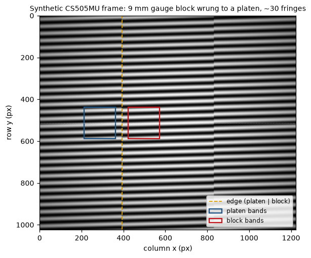
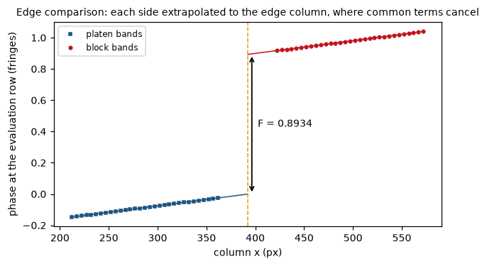
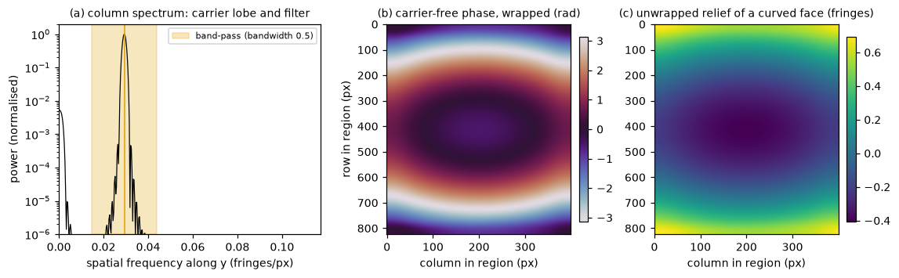
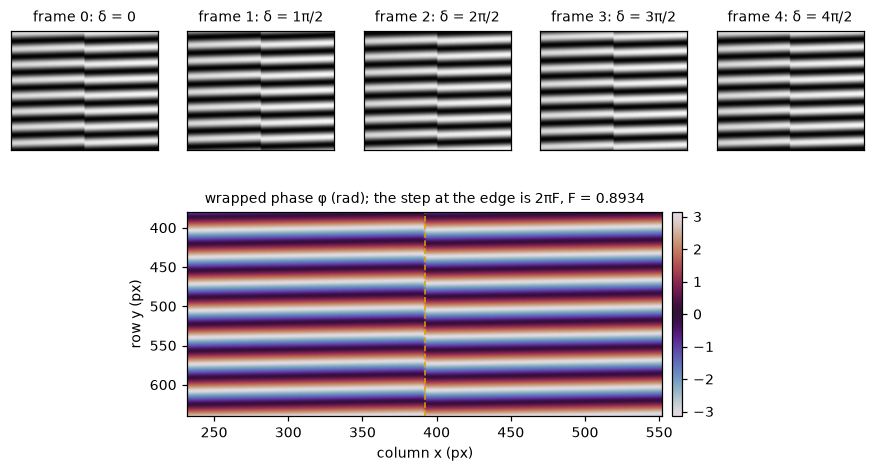
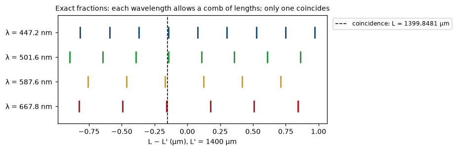

# interflib

Analysis library for the interferometry project of the Instituto Nacional de Metrología
(INM, Colombia): absolute length of gauge blocks from Twyman-Green interferograms.

The library covers the whole chain:

1. **Read the fringe fraction from the image.** Several readers are available: a
   sinusoidal fit, single-shot Fourier demodulation, or phase stepping. Each compares
   the block and platen phases at the edge column, where every phase term common to
   both surfaces cancels.
2. **Correct the wavelength** for the refractive index of air.
3. **Resolve the integer fringe order** by the method of exact fractions, with several
   wavelengths or with one wavelength and a mechanical prior.

A layered interferogram simulator supplies images with a known truth for every step.



*A synthetic frame from the simulator: a 9 mm wide gauge block wrung to a platen, about
30 fringes, CS505MU camera noise. The fraction is read from column bands on each side of
the edge (boxes). Every figure in this README is made with `tools/make_readme_figures.py`.*

## Contents

- [Install](#install)
- [From an interferogram to the fringe fraction](#from-an-interferogram-to-the-fringe-fraction)
  - [Synthetic interferograms](#synthetic-interferograms)
  - [Single shot: comparison at the edge column](#single-shot-comparison-at-the-edge-column)
  - [Single shot: Fourier demodulation](#single-shot-fourier-demodulation)
  - [Phase stepping](#phase-stepping)
  - [Sign of the fraction](#sign-of-the-fraction)
- [From the fraction to the length](#from-the-fraction-to-the-length)
- [End-to-end measurement](#end-to-end-measurement)
- [Conventions](#conventions)
- [Package layout and status](#package-layout-and-status)
- [Development](#development)
- [References](#references)

## Install

```bash
cd code/interflib
python -m venv .venv
.venv/Scripts/activate          # Windows; use source .venv/bin/activate on POSIX
pip install -e ".[dev]"         # editable install with pytest, ruff and nbstripout
pytest
```

The library needs Python 3.10 or later. Its runtime dependencies are numpy, scipy,
matplotlib and opencv-python. The `notebooks` extra adds scikit-image, which one of the
exploration notebooks uses.

## From an interferogram to the fringe fraction

The block surface stands `L` above the platen. In double pass, the fringes on the block
are shifted against those on the platen by the **fringe fraction**
`F = frac(2L/λ)`, the part of the interference order that an image can show.

Every reader below returns `F` at a chosen **edge column** and **evaluation row**. The
reason is that `F` is only free of the instrument when both phases refer to the same
pixel: there, any term common to block and platen cancels, such as the reference tilt or
an air or vibration piston. Comparing two strips at different columns adds `g_x·Δx` as
soon as the fringes are not exactly along the rows.

### Synthetic interferograms

`interflib.simulation` builds a frame in three separable layers:

1. **Optical path.** Reference tilt, block step, flatness of block and platen, wringing
   wedge and low-order aberrations.
2. **Image formation.** Gaussian beam with vignetting, fringe visibility and blur.
3. **Sensor.** Shot and read noise, gain, quantisation and saturation.

It returns the image together with the truth. The examples in this section share the
scene below: a 2 mm block that is 51 nm long, read at 543.5 nm.

```python
from dataclasses import replace

import numpy as np

from interflib.simulation import PhaseModel, SceneGeometry, SensorModel, synthesize_interferogram

geometry = SceneGeometry.cs505mu(scale=0.5, fov_mm=25.0)      # 1224 x 1024 px, block centred
model = PhaseModel(wavelength_nm=543.5,                        # wavelength in the medium
                   central_length_nm=2_000_051.0,              # L = 2 mm + 51 nm
                   fringes_y=30.0, fringes_x=1.0)              # reference tilt, slightly rotated
sim = synthesize_interferogram(geometry, model, sensor=SensorModel.cs505mu(), seed=0)

img = sim.image.astype(float)        # 12-bit counts
# the truth: fraction at the block centre
print(round(sim.fraction_truth, 4))  # -> 0.8933
```

### Single shot: comparison at the edge column

`edge_fraction` fits a sinusoid along the rows to narrow column bands, from 30 to 180 px on
each side of the edge. It then fits a straight line to the band phases of each side and
takes the difference of the two lines at the edge column. The platen must lie to the left
of the edge; mirror the image for the opposite layout.

```python
from interflib.fringe.edge_comparison import detect_edge_column, edge_fraction

height, width = img.shape
edge_x = detect_edge_column(img, search=(0, width // 2)) - 0.5   # boundary between columns
eval_row = height // 2
rows = (eval_row - 75, eval_row + 75)                            # fit window along y

res = edge_fraction(img, edge_x, rows, eval_row, period_guess=height / 30)
print(f"F = {res.fraction:.4f} ± {res.fraction_error:.4f}")      # -> F = 0.8934 ± 0.0001
```

`fraction_error` is the standard uncertainty of `F` that comes from the extrapolation to
the edge. It does not cover systematic effects. On real images, refine the edge with
`edge_line_centre`, which finds the centre of the dark line that the chamfer draws.

The lines cross the 30 px next to the edge where no band is read, so `F` assumes that
the side phases stay straight up to the edge. `span_sensitivity` repeats the comparison
with the bands from 45 or 60 px, or up to 120 px, and gives the largest change of `F`,
which is also its standard uncertainty (`model_error`): with the image blurred coherently
across the edge, simulations gave biases of up to 1.2 times that change. On the 2026-10
bench images `F` moved by 1 to 15 nm this way, well above `fraction_error`.

```python
from interflib.fringe.edge_comparison import span_sensitivity

sens = span_sensitivity(res.platen, res.block, res.edge_x, res.eval_row)
print(f"{sens.deviation:.4f} {sens.model_error:.4f}")          # -> 0.0001 0.0001
```



### Single shot: Fourier demodulation

With a spatial carrier, the Fourier transform of each column separates the fringe term
from the background. A band-pass filter around the carrier gives the phase at every
pixel. `fourier_edge_fraction` does this column by column. `fourier_edge_fraction_2d`
demodulates one region on each surface in two dimensions. Both use the same comparison at
the edge.

```python
from interflib.fringe.fourier import fourier_edge_fraction, fourier_edge_fraction_2d

fft_rows = (100, height - 100)
by_column = fourier_edge_fraction(img, edge_x, rows, eval_row, fft_rows=fft_rows)
two_d = fourier_edge_fraction_2d(img, edge_x, rows, eval_row, fft_rows=fft_rows)
print(f"{by_column.fraction:.4f} {two_d.fraction:.4f}")   # -> 0.8934 0.8934
```

The same demodulation gives a **continuous map** of a surface once the carrier is removed
and the phase is unwrapped. The map is defined up to a plane.

```python
from interflib.fringe.fourier import demodulate_2d, unwrap_phase_map

curved = synthesize_interferogram(geometry, replace(model, block_flatness_pv_nm=600.0),
                                  sensor=SensorModel.cs505mu(), seed=0).image.astype(float)
x0 = int(edge_x) + 20
face = demodulate_2d(curved, fft_rows, (x0, x0 + 400))           # a region on the block face
relief = unwrap_phase_map(face).object_phase / (2 * np.pi)       # fringes
```



`interflib.fringe.diagnostics` adds tools to inspect a real frame:

- `field_overview`: maps of phase, modulation and background over the whole field;
- `edge_from_modulation`: the block edge, taken from the dip in fringe modulation;
- `surface_phase`: the phase of one surface, split into a plane (the wedge) and a residual (the curvature);
- `bandwidth_sensitivity`: how much `F` moves with the filter width.

### Phase stepping

With a stack of frames taken at known phase steps, the phase comes from each pixel alone,
with no carrier needed. `hariharan_five_step` is insensitive to a linear miscalibration of
the step. `edge_fraction_from_phase` reads the fraction from the wrapped map with the
same comparison at the edge.

```python
from interflib.fringe.phase_shifting import edge_fraction_from_phase, hariharan_five_step

frames = [synthesize_interferogram(geometry, replace(model, phase_shift_rad=k * np.pi / 2),
                                   sensor=SensorModel.cs505mu(), seed=k).image.astype(float)
          for k in range(5)]
psi = hariharan_five_step(frames)            # phase, background, modulation, visibility
stepped = edge_fraction_from_phase(psi.phase, edge_x, rows, eval_row, modulation=psi.modulation)
print(f"{stepped.fraction:.4f}")             # -> 0.8934
```

`least_squares_psa` accepts any set of known steps. `interflib.fringe.unwrap` provides
three unwrappers for full maps: Itoh, quality-guided and Goldstein branch cuts.



### Sign of the fraction

One intensity image cannot tell which way the interference order increases, because the
cosine is even. Read the wrong way, the fraction comes out as `1 − F`. The direction is a
property of the set-up's alignment and has to be determined on the bench. One way is a
known displacement; another is a block of certified length. Declare it to the readers
with `order_sign`:

- `+1`, the default: the order increases towards `+y`, down the image.
- `−1`: it decreases towards `+y`.

```python
reversed_tilt = synthesize_interferogram(geometry, replace(model, fringes_y=-30.0),
                                         sensor=SensorModel.cs505mu(), seed=0).image.astype(float)
wrong = edge_fraction(reversed_tilt, edge_x, rows, eval_row, height / 30)
right = edge_fraction(reversed_tilt, edge_x, rows, eval_row, height / 30, order_sign=-1)
print(f"{wrong.fraction:.4f} {right.fraction:.4f}")   # -> 0.1067 0.8933
```

## From the fraction to the length

**Refractive index of air.** This uses the modified Edlén equation of Birch & Downs, in
the form and with the input limits of the NIST Engineering Metrology Toolbox. It
reproduces that document's reference table to within 4·10⁻¹⁰.

```python
from interflib.dimensional.refraction import EdlenRefractiveIndex

air = EdlenRefractiveIndex(temperature=20.0, pressure=75_300.0, relative_humidity=50.0)
lambda_air = air.wavelength_in_air(543.5163)     # vacuum wavelength in, nm
print(f"{air.index_refraction(543.5163) - 1:.4e} {lambda_air:.4f}")   # -> 2.0260e-04 543.4062
```

**Several wavelengths.** Each wavelength allows a comb of lengths spaced `λ/2` apart;
only one length is consistent with all of them. `MultiwavelengthEFSolver` anchors the
sub-fringe position on the first wavelength and picks the integer orders that minimise
the residual. It also reports the `margin` to the runner-up, which warns of an ambiguous
choice. `CoincidenceEFSolver` scans the combs directly and serves as an independent
cross-check. The example below is the four-wavelength measurement of a 1400 µm block
published by Liu et al. (2022).

```python
from interflib.dimensional.coincidence import CoincidenceEFSolver
from interflib.dimensional.multiwavelength import MultiwavelengthEFSolver

wavelengths = [667.8184, 587.5649, 501.5702, 447.1501]   # in air, nm; the first is the anchor
fractions = [0.28, 0.85, 0.90, 0.23]

multi = MultiwavelengthEFSolver(wavelengths).solve(
    nominal_length=1_400_000.0, nominal_tolerance=1_000.0, fringe_fractions=fractions)
print(f"{multi.length / 1000:.6f} {multi.integer_orders}")   # -> 1399.840861 [4192, 4764, 5581, 6261]

comb = CoincidenceEFSolver(wavelengths).solve(1_400_000.0, 1_000.0, fractions)
print(f"{comb.length / 1000:.4f} {comb.is_unique}")          # -> 1399.8481 True
```

The two solvers agree on the integer orders. Their lengths differ by 7 nm because each
places the length within the fringe differently:

- `CoincidenceEFSolver` averages the nearest comb line of every wavelength, weighted by
  `(2/λ)²`.
- `MultiwavelengthEFSolver` takes the position within the fringe from the first wavelength.

The spread reflects how consistent the published fractions are, which are given to two
decimals only.



**One wavelength and a mechanical prior.** `MonochromaticEFMSolver` (MEFM) picks the only
candidate that falls within `δ ± U` of the mechanically measured deviation. For the
candidate to be unique, `U` must stay below `λ/4`. A certificate gives the deviation at
20 °C while the fraction is measured at the block temperature: with `cte` and `temp_c` the
solver expands the nominal to that temperature and reduces each candidate to 20 °C before
testing it (without them it is only right at 20 °C; a 100 mm steel block moves 115 nm per
0.1 K). Here it recovers the simulated block from the fraction measured above.

```python
from interflib.dimensional.mefm import MonochromaticEFMSolver

mefm = MonochromaticEFMSolver(wavelength=543.5)   # the wavelength of the simulated scene
block = mefm.solve(nominal_length=2e6,             # L', nm
                   prior_length_dev=55.0,          # mechanical deviation from nominal, nm
                   prior_U=30.0,                   # its expanded uncertainty, nm
                   fringe_fraction=res.fraction,
                   cte=11.5e-6, temp_c=20.0)       # block expansion, 1/K, and temperature, C
# deviation from nominal accepted by the optics, nm
print(f"{block.length_dev:.1f}")                    # -> 51.0
```

**One wavelength, nominal length as prior.** `GaugeBlockLength` is the classical
single-wavelength computation. It works when the block is within `λ/4` of its nominal
length, and it reduces the result to 20 °C. `GaugeBlockLength.from_environment` takes the
vacuum wavelength and the air conditions, and computes the air index itself.

```python
from interflib.dimensional.excess_fraction import GaugeBlockLength

classic = GaugeBlockLength(wavelength=543.5, nominal_length=2e6, cte=11.5e-6, temp_c=20.0,
                           fringe_fraction=res.fraction).solve()
# deviation from nominal, nm
print(f"{classic.length_dev:.1f}")                  # -> 51.0
```

**Parity of the reading.** A wrong `order_sign` and a platen declared on the wrong side
each turn the reading into `1 − F`, and two wrong declarations cancel. Neither shows in
the image. `check_fraction_parity` gives the deviation that the other parity would give,
which is what a wrong declaration would cost. It is at least `(λ/2)·|2F − round(2F)|`
away: up to `λ/4` at `F = 0.25`, and nothing at `F = 0` or `0.5`. With a prior and its
standard uncertainty, such as the certificate of a check standard or a pre-measurement,
it also tests both readings. The verdict is `confirmed`, `contradicted`, `undecided`
(both fit) or `inconsistent` (neither fits). The values below are the certified 2 mm
block of the 2026-10 campaign, read at the face centre.

```python
from interflib.dimensional.parity import check_fraction_parity

check = check_fraction_parity(271.7, 51.3, 0.1416)    # lambda/2, d and F of the declared reading
print(f"{check.flipped_length_dev:+.1f} {check.verdict}")    # -> -25.6 unverified
check = check_fraction_parity(271.7, 51.3, 0.1416, prior_length_dev=51.0, prior_u=10.0, u_length=10.0)
print(f"{check.z:+.2f} {check.flipped_z:+.2f} {check.verdict}")   # -> +0.02 -5.42 confirmed
```

## End-to-end measurement

`tools/run_calibration.py` runs the whole chain on one block and prints a summary:

- the inputs, each with its origin (sidecar, command line, assumption);
- the air correction;
- the image: edge, face centre, period, visibility, saturation and wedge;
- the fraction from the three single-shot readers, with their spread, the repeatability over the frames, how far
  the choice of bands moves it (`span_sensitivity`, which enters `u(F)`), and the value at the face centre with the
  uncertainty of its position;
- the integer order, from the nominal and, given a prior, by MEFM;
- the length at 20 °C;
- the parity of the reading: the length with `1 − F`, and the test of both readings against the prior
  (`--prior-dev-nm`, `--prior-U-nm` with `k = 2`, and `--u-other-nm` for the rest of the optical uncertainty);
  without a prior the parity is reported as not verified;
- the warnings that apply.

The block is found without assuming where it is or how it is oriented (`interflib.fringe.geometry.locate_block`): the
fringe zone comes from the Fourier modulation, and the edge from a line of phase steps inside it that the dark chamfer
line confirms. With wide fringes the demodulation also draws stray lines of phase steps, with as much support as the
edge, and these have no dark line along them. When no phase-step line has the dark line, the edge is the dark line
nearest the platen side. When there is no dark line at all, the edge rests on the phase step alone and the summary
warns that it is unconfirmed (`edge_source` in the result). The frames are then rotated (if the edge is more than 1° from vertical) and mirrored
(if the platen is on the right) so that the readers see a vertical edge with the platen on the left. The side of the
platen is **declared** (`--platen-side`, or `lado_platina` in the sidecar; left by default, with a warning): the
phase cannot tell it, and the wrong side reads `1 − F`. With too few fringes for the demodulation the script falls
back to the bench heuristic.

The central length is defined at the centre of the free measuring face (ISO 3650:1998, clause 3), so `F` is read
there when the centre can be placed (`interflib.fringe.geometry.locate_face_centre`). The modes are tried in this
order:

1. **outline**: both lateral edges and both ends of the face are found, and the centre is their midpoint. No
   input is needed. This needs the whole block in the field with platen around it.
2. **outline and dimensions**: `--face-mm WIDTH LENGTH` (with `--u-face-mm`), or `cara_mm` and `u_cara_mm` in the
   sidecar, fills in what the field does not show. The scale comes from the pair of lateral edges, or else the pair of ends, or else `--pixel-mm`. An axis
   with one feature only takes that feature plus half the dimension. The dimensions belong to the block, so they
   are given once and hold for every series and position.
3. **manual**: `--face-centre Y X` in pixels of the input frames, with `--u-face-centre-px`.

The far edge is taken with the same order of preference as the edge (phase-step line with the dark chamfer line,
dark line, phase-step line). When none of these is found, the end of the lit field is taken, which may be the border
of the beam. A far edge without the dark line is checked against the declared pixel size (`--pixel-mm`) when the
dimensions are given. The end of the lit field is used only if the width it gives agrees within 5 %, and an
unconfirmed phase-step line is dropped if it disagrees. In the 2026-10 position series the beam clipped the block,
and without this check the centre would have moved by up to 325 px. An end of the face is a line of phase
steps across the face that the platen does not share at the same rows (the border of the beam crosses both), with
fringes on both sides. The evaluation row moves to the centre, and the uncertainty of the position enters `u(F)`
through the wedge, `u_pos(F)² = (Δg_x·u(x_c))² + (Δg_y·u(y_c))²`. Without a centre, `F` is read at the edge column
and the summary warns.

At the centre the block phase is measured there: the readers take `at_x`, read the block bands at `x_c ± 75` px
and interpolate their line at `x_c`. Only the platen line is extended, about 280 px, because the block hides the
platen. Both phases still refer to one pixel, so the reference tilt still cancels, but the platen is assumed
straight over the extension. `u(F)` therefore adds a type B bound, `u_ext(F)` (`--u-platen-extension`, 0.065 fringe
by default). It comes from the one check available on the 2026-10 bench: there the straight platen line missed the
platen visible above the 2 mm block by that much. With platen on both sides of the block it should be replaced by a
check in every image. `--face-centre-x` keeps its earlier meaning: `F` is extended to that column at the
evaluation row.

Without arguments it measures a simulated 2 mm block and also reports the error against the truth. `--series` reads
a real burst and its `.meta.yaml` sidecar; this needs the `tools` extra (pyyaml). A value missing from the sidecar,
such as the pressure, has to be given on the command line: the script stops rather than assume it. `--json` writes
the same summary to a file. `--plot` saves a figure of the areas used, so that each series can be checked: the frame,
a zoom around the edge with the platen and block bands and the Fourier regions, and the band phases with the two
lines extended to the edge.

```bash
python tools/run_calibration.py                                   # simulated block
python tools/run_calibration.py --block-size-mm 9 14                # simulated block, whole face in the field
python tools/run_calibration.py --series DATA/20261005_L1_tg-inm_2mm_repet-2_serie-010     --pressure 75300 --face-mm 9 30 --json summary.json --plot areas.png
```

```
Length at 20 C : 2.0000510 mm   (d = +51.0 nm from nominal; F contribution u = 0.02 nm)
...
Fringe fraction (order_sign +1; primary: fourier)
    sine       F = 0.1637   u_e(F) = 0.0000
  * fourier    F = 0.1636   u_e(F) = 0.0000
    fourier2d  F = 0.1636   u_e(F) = nan
  spread between methods 0.0001 fringe (0.0 nm)
  repeatability (5 frames) s = 0.0001, s/sqrt(n) = 0.0000 fringe
  ...
  band choice   gap-span px: 30-180 0.1636, 45-180 0.1636, 60-180 0.1636, 30-120 0.1635; u_m(F) = 0.0000 (0.0 nm)
...
Truth          F = 0.1636, L = 2.0000510 mm;   error F -0.0000, L -0.00 nm
```

The contribution `u(F)·λ/2` covers only the reading of the fraction. It is not the calibration uncertainty, which
also includes the air, the temperatures, the wavelength, the phase change and the wringing film.

## Conventions

- **Units.** Wavelengths and lengths are in nanometres throughout the public API. Images
  are rows × columns: `y` is the row index, increasing downwards, and `x` is the column
  index.
- **Names.** Arguments and results use the names of the project nomenclature:
  - `wavelength` and `wavelength_vac`;
  - `nominal_length` (`L'`), `length` (`L`) and `length_dev` (`L − L'`);
  - `fringe_fraction` (`F`), `cte` (`α`), `temp_c` (`t`) and `n_air`.

  The former names still work during a transition and raise a `DeprecationWarning`:
  - `GaugeBlockLength(lambda_air, Lp [mm], C, t_block, obs_fraction)` and `block_length()`
    (mm);
  - `MonochromaticEFMSolver.evaluate_block()`, which returns a dict;
  - `fractions=` in the multi-wavelength solvers, and `.correction` in their results;
  - `pixels_between_fringes=` in `FringeFractionMeasurement`.
- **Phase.** The column phases are those of `A·sin(w·y + φ) + C` with `w > 0`, so the
  phase increases towards `+y`. The fraction is
  `F = frac(order_sign·(φ_block − φ_platen)/2π)`.
- **Constants.** Physical constants live in `src/interflib/constants.py`, each with its
  source in a comment. The algorithms contain no magic numbers.
- **Tests.** Every method has tests. Where an analytic solution or a published reference
  value exists, the test checks against it. `tests/test_readme.py` runs the code of this
  README.
- **Sources.** The repository is self-contained. Where a step, algorithm or value rests on
  a reference, the docstring cites that source directly.

## Package layout and status

The project uses a `src` layout. Only `src/interflib/` is installed; everything else
supports development.

```
interflib/
├── src/interflib/
│   ├── constants.py        physical constants, each with its source
│   ├── simulation/         layered synthetic interferograms with ground truth
│   ├── fringe/             fringe image -> phase -> fraction
│   ├── dimensional/        air index and exact fractions -> length
│   ├── io/                 image loading (sidecar validation: placeholder)
│   ├── preprocessing/      placeholder
│   ├── uncertainty/        placeholder (GUM and Monte Carlo propagation)
│   └── vibration/          placeholder (heterodyne, fringe counting)
├── tests/                  pytest suite, synthetic signals and published reference values
├── tools/                  run_calibration.py, select_roi.py, make_readme_figures.py
├── notebooks/              exploration only
├── docs/images/            figures of this README
└── simulations/            interferograms of the earlier prototype
```

| Module | What it provides |
|---|---|
| `simulation` | `synthesize_interferogram` with `SceneGeometry`, `PhaseModel`, `Illumination`, `SensorModel`; presets for the Thorlabs CS505MU camera |
| `fringe.edge_comparison` | `edge_fraction`, `fraction_at_edge`, `span_sensitivity`, `column_phases`, `detect_edge_column`, `edge_line_centre` |
| `fringe.fourier` | column and 2-D demodulation, `fourier_edge_fraction(_2d)`, carrier-free phase, `unwrap_phase_map` |
| `fringe.phase_shifting` | `least_squares_psa`, 3/4/5-step algorithms, `edge_fraction_from_phase`, `fraction_from_phase` (strips) |
| `fringe.unwrap` | Itoh, quality-guided and Goldstein branch-cut unwrapping, residues |
| `fringe.diagnostics` | whole-field maps, edge from the modulation, surface phase, filter-width sensitivity |
| `fringe.geometry` | `locate_block`: fringe zone, block edge from the phase steps confirmed by the dark chamfer line, rest of the face outline (far edge, ends), rotation and mirroring for the readers; `locate_face_centre`: centre of the measuring face from the outline, the face dimensions or by hand |
| `fringe.wedge` | block-platen wedge along `x` and `y`, in fringes/px and µrad |
| `fringe.profile_fit` | two-strip sinusoidal fit (`FringeFractionMeasurement`), kept for strip analyses |
| `fringe.models` | sine model, seed and branch, fit quality, `signed_fraction` |
| `dimensional.refraction` | `EdlenRefractiveIndex`: index of air and wavelength in air |
| `dimensional.multiwavelength` | `MultiwavelengthEFSolver` |
| `dimensional.coincidence` | `CoincidenceEFSolver` |
| `dimensional.mefm` | `MonochromaticEFMSolver` |
| `dimensional.excess_fraction` | `GaugeBlockLength` |
| `dimensional.parity` | `check_fraction_parity`: the reading `F` against `1 − F`, and its test against a prior |
| `io.images` | Unicode-path-safe image loading |

The modules `io.meta`, `preprocessing`, `uncertainty` and `vibration` are still
placeholders.

## Development

```bash
pytest                                  # full suite
ruff check src tests tools              # lint rules in pyproject.toml
python tools/make_readme_figures.py     # regenerate docs/images/
```

Notebooks are for exploration only. Once a method works, it is promoted into the package
with its tests.

## References

- K. P. Birch, M. J. Downs, "An updated Edlén equation for the refractive index of air",
  *Metrologia* 30, 155–162 (1993); correction, *Metrologia* 31, 315–316 (1994).
- J. A. Stone, J. H. Zimmerman, "Index of Refraction of Air", NIST Engineering Metrology
  Toolbox, https://emtoolbox.nist.gov/Wavelength/Documentation.asp.
- T. Liu, J. Wu, R. Sato, H. Matsukuma, W. Gao, "Theoretical analysis on gauge block
  length measurement by Excess Fraction method", Nanoman-AETS, IEEE (2022).
- J. E. Decker et al., "Increasing the range of unambiguity in step-height measurement
  with multiple-wavelength interferometry", *Appl. Opt.* 42(28), 5670–5678 (2003).
- J. E. Decker, R. Schödel, G. Bönsch, *Metrologia* 41, L11–L17 (2004),
  doi:10.1088/0026-1394/41/3/L03.
- T. Doiron, J. Beers, *The Gage Block Handbook*, NIST Monograph 180 (1995).
- J. S. Rojas-Rodríguez, J. L. Galvis Arroyave, H. Vinck-Posada, "Absolute Gauge Block
  Calibration: A Single-Wavelength Excess Fraction Method Assisted by High-Precision
  Mechanical Pre-measurement", preprint, INM (2026).
- M. Takeda, H. Ina, S. Kobayashi, *J. Opt. Soc. Am.* 72, 156–160 (1982).
- M. Servín, J. A. Quiroga, J. M. Padilla, *Fringe Pattern Analysis for Optical
  Metrology*, Wiley-VCH (2014).
- P. Hariharan, B. F. Oreb, T. Eiju (1987), five-step phase-shifting algorithm.
- R. M. Goldstein, H. A. Zebker, C. L. Werner, *Radio Sci.* 23, 713 (1988).
- Thorlabs, CS505MU camera datasheet (ITN002518-D02).

## License

BSD 3-Clause License. Copyright (c) 2026, Instituto Nacional de Metrología de Colombia
(INM); see [LICENSE](LICENSE). The authors are listed in [AUTHORS.md](AUTHORS.md). To cite
the library, use [CITATION.cff](CITATION.cff) (GitHub shows it as *Cite this repository*).
